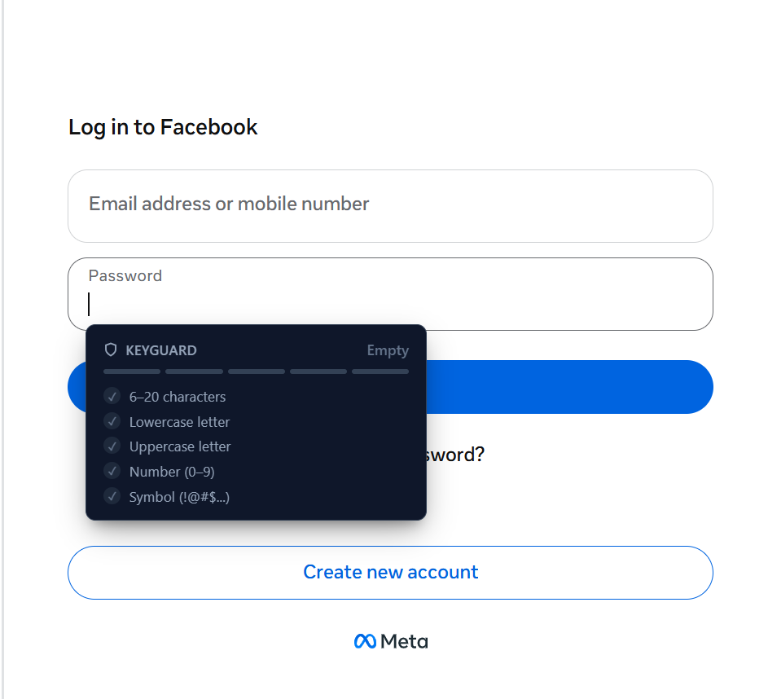
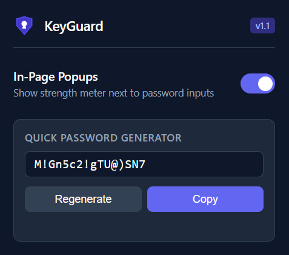
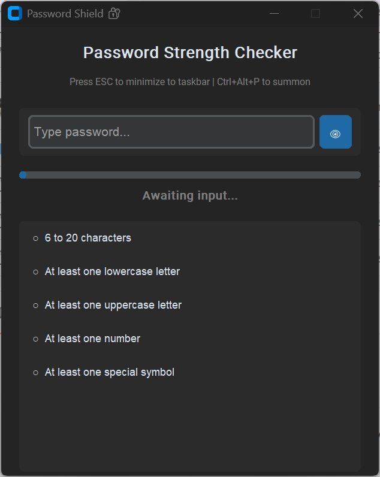

# KeyGuard & Password Shield 🔐

A lightweight, modern, zero-telemetry suite designed to evaluate and generate robust passwords. This repository provides two complementary implementations:

1. **Password Shield (Desktop App)**: A modern Python desktop application that docks neatly in your system taskbar and summons instantly on top of any active window with a global hotkey (`Ctrl+Alt+P`).
2. **KeyGuard (Browser Extension)**: A Chromium Manifest V3 extension featuring an interactive toolbar popup, a secure 16-character password generator, and an automatic in-page strength meter attached to any `<input type="password">` field across the web.


## 📸 Previews

<table>
  <tr>
    <td align="center" width="35%">
      <strong>In-Page Detection</strong><br><br>
      
    </td>
    <td align="center" width="35%">
      <strong>Extension Popup</strong><br><br>
      
    </td>
    <td align="center" width="30%">
      <strong>Desktop App</strong><br><br>
      
    </td>
  </tr>
</table>

## Table of Contents

- [Password Security Criteria](#password-security-criteria)
- [Option 1: Desktop Application (Python / CustomTkinter)](#option-1-desktop-application-python--customtkinter)
  - [Features](#features)
  - [Prerequisites & Installation](#prerequisites--installation)
  - [Usage](#usage)
- [Option 2: Browser Extension (Chromium Manifest V3)](#option-2-browser-extension-chromium-manifest-v3)
  - [Features](#features-1)
  - [Installation in Your Browser](#installation-in-your-browser)
  - [Usage](#usage-1)
- [Repository Structure](#repository-structure)
- [Security & Privacy](#security--privacy)
- [License](#license)

---

## Password Security Criteria

Both tools evaluate passwords against a strict 5-point benchmark:

| Criterion | Rule |
| :--- | :--- |
| **Length** | Between 6 and 20 characters (inclusive) |
| **Lowercase** | At least one lowercase letter (`[a-z]`) |
| **Uppercase** | At least one uppercase letter (`[A-Z]`) |
| **Digits** | At least one numeric digit (`[0-9]`) |
| **Special Characters** | At least one special symbol (`[!@#$%^&*(),.?":{}|<>]`) |

- **Score 5/5**: Strong Password (Accepted) 🚀
- **Score 3–4/5**: Medium Strength ⚠️
- **Score 0–2/5**: Weak Password ❌

---

## Option 1: Desktop Application (Python / CustomTkinter)

### Features

- **Modern Dark UI**: Powered by `customtkinter` with real-time feedback meters and checklists.
- **Instant Peek Toggle**: Show or hide the input text using the `👁` / `🔒` button.
- **Global Hotkey Daemon**: Press `Ctrl + Alt + P` anywhere in your operating system to summon the window to the foreground.
- **Taskbar Docking**: Press `Esc` to minimize the window straight to your taskbar without terminating the background hotkey listener.

### Prerequisites & Installation

Requires **Python 3.10+**.

```bash
# 1. Clone the repository
git clone https://github.com/your-username/password-shield.git
cd password-shield

# 2. Create and activate a virtual environment (recommended)
python -m venv .venv
# On Windows:
.venv\Scripts\activate
# On macOS / Linux:
source .venv/bin/activate

# 3. Install required packages
pip install customtkinter pynput
```

### Usage

```bash
python desktop_popup.py
```

- **Summon Window**: Press `Ctrl + Alt + P` anywhere across your OS.
- **Minimize to Taskbar**: Press `Esc`.

---

## Option 2: Browser Extension (Chromium Manifest V3)

Fully compatible with **Google Chrome**, **Brave**, **Microsoft Edge**, **Opera**, and other Chromium-based browsers.

### Features

- **Automatic Contextual Detection**: Hooks into all `input[type="password"]` fields (including dynamic single-page web applications built with React, Vue, or Angular).
- **Non-Intrusive Floating Meter**: Shows a sleek 5-segment bar and live criteria checks beneath the focused input, then hides automatically on blur.
- **Toolbar Companion Menu**:
  - Instant **Enable/Disable switch** to toggle in-page popups without removing the extension.
  - Built-in **16-character Strong Password Generator** using cryptographically secure random values (`crypto.getRandomValues()`), complete with a one-click copy button.
- **Dedicated Shield Icons**: Provided in standard sizes (16x16, 48x48, 128x128).

### Installation in Your Browser

1. Download or extract the `keyguard-extension-v2` directory.
2. Open your browser and navigate to the extensions manager:
   - Chrome / Brave: `chrome://extensions/`
   - Edge: `edge://extensions/`
3. Toggle on **Developer mode** (top-right corner).
4. Click **Load unpacked** (top-left).
5. Select the `keyguard-extension-v2` folder.

### Usage

- **On Any Website**: Click into any password field (login, signup, reset) and begin typing to see the floating companion bar in action.
- **From Your Browser Toolbar**: Click the KeyGuard shield icon to generate fresh random credentials or toggle the in-page overlay off/on.

---

## Repository Structure

```text
├── desktop/
│   └── desktop_popup.py      # CustomTkinter local app with global hotkey daemon
│
├── extension/
│   ├── manifest.json         # Chromium Manifest V3 configuration
│   ├── popup.html            # Toolbar popup interface (generator + toggle)
│   ├── popup.js              # Toolbar popup script
│   ├── content.js            # In-page password input detector & overlay
│   ├── style.css             # Floating overlay stylesheet
│   └── icons/                # Dedicated security shield icons
│       ├── icon16.png
│       ├── icon48.png
│       └── icon128.png
│
└── README.md
```

---

## Security & Privacy

- **100% Local Execution**: No keystrokes, passwords, or evaluation events are ever transmitted over the network.
- **Cryptographic Randomness**: The browser extension uses the native `window.crypto.getRandomValues()` API to generate entropy-safe passwords.

---

## License

Distributed under the **MIT License**. See `LICENSE` for details.


**❤️ Made with love: Zaynab**
